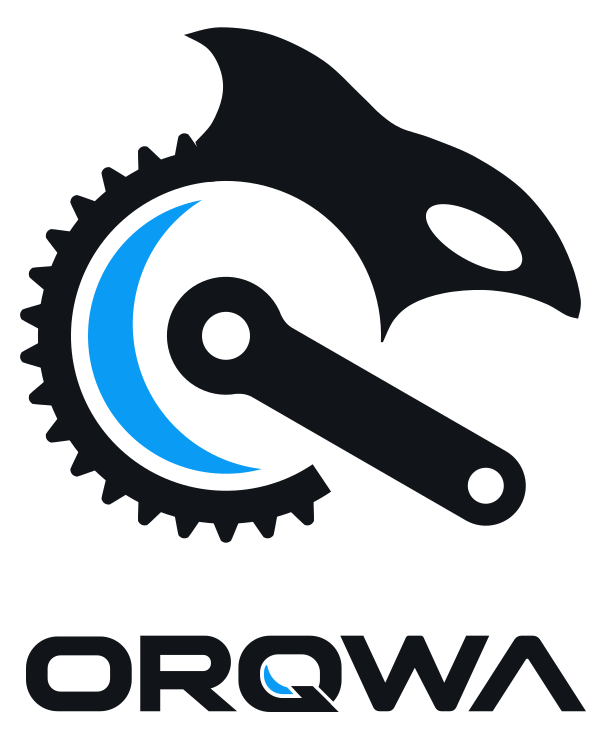
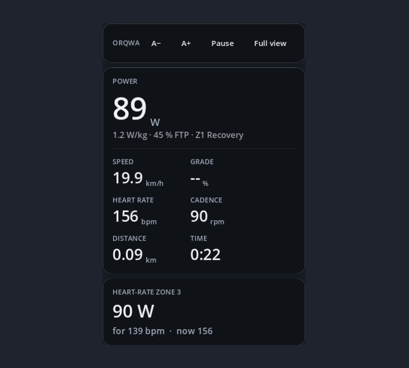

  <picture>
    <source media="(prefers-color-scheme: dark)" srcset="docs/brand/orqwa-lockup-dark.svg">
    
  </picture>

<strong>Make waves with watts, not payments</strong>

Open-source · Free · Local-first · Indoor cycling

  
  
  
  
  

A modern, offline-first, open-source and free indoor cycling app. Import a GPX route or a ride video and
ride it on your smart trainer, through a generated 3D world or along the video.

<table>
  <tr>
    <td colspan="2" align="center">
       
      Any GPX route as a 3D world, here along the Bielersee
    </td>
  </tr>
  <tr>
    <td colspan="2" align="center">
       
      Along a real video, played at your speed
    </td>
  </tr>
  <tr>
    <td colspan="2" align="center">
       
      Just your HUD, on top of any window
    </td>
  </tr>
</table>

Video: <a href="https://cycling.vangestel.online">“Le petit Menglonnais”</a> by Fred Van
Gestel, <a href="https://creativecommons.org/licenses/by-nc-sa/4.0/">CC BY-NC-SA 4.0</a>.

[More screenshots: app, workouts, cities, forests and route scenery](docs/screenshots.md).

> [!WARNING]
> **Written by AI, ridden at your own risk.** Every line of ORQWA is written by AI. It comes
> with no warranty of any kind, and we accept no liability for injury to you or for damage to
> your trainer, bike or any other gear (sections 15 and 16 of the [GPL-3.0](LICENSE)).

> [!NOTE]
> ORQWA is in early development: [docs/PLAN.md](docs/PLAN.md) shows what is done and what
> comes next.

## Features

<table>
  <tr>
    <td width="50%">🚴 <b><a href="https://github.com/ORQWA/ORQWA/wiki/Devices-and-riding#devices">Smart trainers</a></b> 
      Bluetooth FTMS and Tacx FE-C over Bluetooth (SIM, ERG, resistance), plus heart-rate straps; your devices reconnect at start and after dropouts</td>
    <td width="50%">🗺️ <b><a href="https://github.com/ORQWA/ORQWA/wiki/Courses#import-a-course">Any GPX in 3D</a></b> 
      A stylized world from real terrain and OpenStreetMap, with weather and time of day. Network is only needed once on import, then it works completely offline.</td>
  </tr>
  <tr>
    <td>🎬 <b><a href="https://github.com/ORQWA/ORQWA/wiki/Video-courses">Video courses</a></b> 
      GoPro, Incyclist, Tacx RLV or any video matched to a GPX; it plays at your speed</td>
    <td>💪 <b><a href="https://github.com/ORQWA/ORQWA/wiki/Workouts">Workouts</a></b> 
      Hold a power or a heart rate, ZWO / ERG / MRC / FIT with an editor, three FTP tests</td>
  </tr>
  <tr>
    <td>⚙️ <b><a href="https://github.com/ORQWA/ORQWA/wiki/Devices-and-riding#virtual-gears">Virtual gears</a></b> 
      24 gears on a single cog, shifted from the keyboard, Shimano Di2 hood buttons, a Zwift Click (original or v2) or <a href="https://github.com/ORQWA/ORQWA/wiki/Devices-and-riding#remote">a phone or tablet in the browser</a></td>
    <td>🪟 <b><a href="https://github.com/ORQWA/ORQWA/wiki/Overlay">Overlay</a></b> 
      Just your HUD, on top of a video or any other window</td>
  </tr>
  <tr>
    <td>👻 <b><a href="https://github.com/ORQWA/ORQWA/wiki/Ghosts-and-pacers">Ghosts &amp; pacers</a></b> 
      Race your best ride, a friend's activity or a pacer at your FTP</td>
    <td>📈 <b><a href="https://github.com/ORQWA/ORQWA/wiki/Ride-history">History &amp; records</a></b> 
      Your power curve and profile, fitness, progress, records per course, climb and duration,
      FIT export and <a href="https://github.com/ORQWA/ORQWA/wiki/Uploading-rides">upload to intervals.icu and Strava</a></td>
  </tr>
</table>

📴 Ride offline on any computer · ⚖️ realistic physics, adjustable difficulty ·
🎛️ a HUD your way · 🌍 English and German · 🖥️ macOS, Windows and Linux

[Wind and bicycle sound](https://github.com/ORQWA/ORQWA/wiki/Devices-and-riding#wind-and-bicycle-sound)
follows your speed, pedaling and coasting in 3D, with independent volume controls.

[Moments](https://github.com/ORQWA/ORQWA/wiki/Devices-and-riding#moments) such as a climb topped,
a new record or halfway pop up on a card while you ride, in a cheering or plain voice.

Error explanations follow your rider's language; [technical details](https://github.com/ORQWA/ORQWA/wiki/Riders#language-and-error-details)
remain available separately after notifications disappear.

**Planned:** hardware video decoding, the overlay on Windows and Linux — see [docs/REQUIREMENTS.md](docs/REQUIREMENTS.md).

## Using ORQWA

The [usage wiki](https://github.com/ORQWA/ORQWA/wiki) covers riding and every feature. Start
with [Getting started](https://github.com/ORQWA/ORQWA/wiki/Getting-started); testers can ride a
trainer without the app with the [command-line tool](https://github.com/ORQWA/ORQWA/wiki/Command-line-tool).
The **[Group Rides](https://github.com/ORQWA/ORQWA/wiki/Group-rides)** tab creates or joins
private eight-rider lobbies. The host selects a 3D course or structured workout, participants
receive it directly, and everyone starts together once ready. See friends on the road, map
and profile, with distance gaps beside the ride. The organizer chooses **Drafting** and
**Keep together** before starting; assisted rides count for training and measured-power records,
but set no course or climb speed records. Optional voice starts microphone-muted
and records no audio. The [CLI workflow](https://github.com/ORQWA/ORQWA/wiki/Command-line-tool#ride-with-others)
continues to support rides using a shared local GPX.

[Syncing between devices](https://github.com/ORQWA/ORQWA/wiki/Syncing-between-devices) explains
how to share ride history, courses and rider settings through a file-sync client such as Nextcloud.

## Download

Tagged builds for macOS (Apple silicon), Windows and Linux are published on the
[Releases page](https://github.com/ORQWA/ORQWA/releases), with the app and CLI
archives attached. Between releases, download artifacts from the
[CI runs on `main`](https://github.com/ORQWA/ORQWA/actions/workflows/ci.yml?query=branch%3Amain)
while signed in to GitHub. [docs/development.md](docs/development.md#builds) explains the files.

## Contributing

Everything runs in a dev container: setup, checks and builds are in
[docs/development.md](docs/development.md). Conventions: [CLAUDE.md](CLAUDE.md); architecture
decisions: [docs/adr/](docs/adr/); third-party assets: [docs/CREDITS.md](docs/CREDITS.md).

## License

[GPL-3.0](LICENSE). The app's settings show, under About, the licence of everything built into it:
the Godot engine, FFmpeg, every Rust crate, and others' models and data. The video-course
screenshot shows a frame of a CC BY-NC-SA 4.0 video and is under that licence (see
[docs/CREDITS.md](docs/CREDITS.md)).
