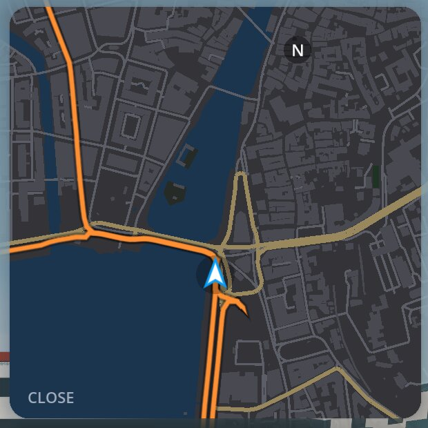
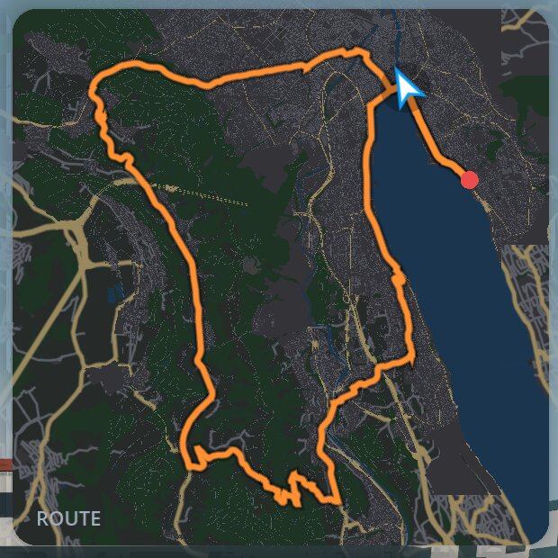

# Native city course measurements

2026-10-25, Apple M5 Pro / 64 GB, AC power, Metal 4.0, Forward+, Godot 4.7.2.
These measurements explain why a city course rode slowly on one Mac; they do not establish
performance on an M1, Android, Windows or Linux, or in fullscreen.

## Conditions

- The Zürich course (37.9 km, 431 chunks; its minimap 5,727 map lines with 17,053 points),
  its world built afresh from the course's saved inputs. Ultra preset, Midday / Clear, chase
  camera, the rider paused at 2,510 m (Bellevue), 2,903 m (Bürkliplatz), 34,743 m (old
  town) and 20,000 m (fields and forest south of the city).
- Window 1600 × 900, rendered at 3240 × 2036 pixels on the Retina display. V-Sync off, frame
  limit unlimited. 5 seconds settling, then 3 seconds of rendered-frame wall times per
  sample; figures are medians.
- The installed ORQWA 0.5.1 executable and GDExtension (466872f) with resource packs exported
  in Docker from this branch; before and after differ only in `app/scenes/minimap.gd`.

## The minimap

Every frame, the minimap drew every line of the map around the whole route anew, as
antialiased polylines that Godot triangulates and uploads each time. On this course that
alone took 85–90 ms a frame, wherever the rider was: the 3D world made no difference.
Now the map is drawn once per view and size and the layer holding it is only moved and turned.

| Place | View | Before | After | Minimap hidden |
|---|---|---:|---:|---:|
| Bellevue | Close | 9.8 fps (102.4 ms) | 51.3 fps (19.5 ms) | 59.8 fps (16.7 ms) |
| Old town | Close | 9.4 fps (106.7 ms) | 48.2 fps (20.8 ms) | 55.4 fps (18.0 ms) |
| Bellevue | Whole route | 9.7 fps (102.8 ms) | 52.4 fps (19.1 ms) | 59.8 fps (16.7 ms) |
| Old town | Whole route | 9.4 fps (106.2 ms) | 48.8 fps (20.6 ms) | 55.4 fps (18.0 ms) |
| Fields and forest | Close | 9.1 fps | 30.5 fps | 31.5 fps |

The maps look the same: of the close views' 620 × 620 pixel crops, 0 and 2 pixels differ by
more than 2 %; in the whole-route view only the 3D scene around the panel differs (clouds and
wind move between captures). The 1.2–2.8 ms the minimap still costs is one draw per line.

| View | Before | After |
|---|---|---|
| Close |  |  |
| Whole route |  |  |

## Where the rest of a city frame goes

With the minimap hidden: how much shorter the median frame became with one thing removed
(ms). The first row is an upper bound for drawing distant ground more cheaply: those chunks'
ground, streets, sidewalks and water simply hidden beyond 600 m from the camera.

| Removed | Bellevue (16.7) | Bürkliplatz (23.2) | Old town (18.6) |
|---|---:|---:|---:|
| Ground, streets, sidewalks and water beyond 600 m | 4.4 | 9.3 | 6.0 |
| All terrain | 3.2 | 5.7 | 2.8 |
| Sun shadows | 2.4 | 2.6 | 2.5 |
| MSAA 2× | 1.3 | 2.9 | 2.5 |
| Mapped streets and tracks | 1.9 | 2.8 | 1.9 |
| Sidewalks, curbs and forecourts | 1.3 | 1.3 | 0.6 |
| Grass | 1.0 | 1.1 | 1.6 |
| All building models | 0.7 | 0.2 | 0.1 |
| Building models to 300 m rather than 900 m | 0.7 | 0.4 | 0.0 |
| Reflections, ambient occlusion, bloom or soft shadows, each | ≤ 0.6 | ≤ 0.6 | ≤ 0.6 |
| No fading of building cells | 0.0 | 0.4 | −0.1 |

In town every street levels the ground across it, so the terrain there is split into pieces
of about 2.7 m, and stays so up to the view distance (8.1 km on Ultra). The distant ground,
not the buildings, is what a city costs on this GPU. Two shadow cascades instead of four
saved 0.2–0.8 ms, a 300 m shadow distance 0.1–0.4 ms. Out of town, at 20 km, trees took
11.3 of 30.9 ms. Building cells fade by their chunk's centre rather than their own (Godot
fades by an instance's origin but hides by its bounds), so near the switch between models
and shells up to 230 cells were drawn transparent, some fully faded out; turning fading off
changed nothing measurable here.

## How these were measured

With an earlier form of the scripts now in `scripts/perf/`
([Measuring frame rate](../development.md#measuring-frame-rate)): a measuring `SceneTree` as the
main loop of a pack exported in Docker, run in a copy of the installed app with a throwaway `HOME`, so the rider's own profile, rides, settings and kept
worlds stayed untouched. The tool opened the course, waited for every chunk, then hid one kind
of geometry, effect or panel at a time. The first runs still showed the update dialog of a
fresh `HOME`, which the scripts now turn off. Software rendering in the dev container gave the
same draw-call and primitive counts but no usable timings.

```sh
COURSE=zurich.tqc PLACES="2510 2903 34743 20000" TAKE=kinds,effects,interface,distance \
    scripts/perf/mac.sh screenshots/perf/measure.pck after
```

To recheck a downloaded build: ride Zürich on Ultra with V-Sync Off and frame limit Unlimited,
pause at the same places, and compare sustained FPS as in
[the tree LOD measurements](tree-lods.md#recheck-a-downloaded-build).
