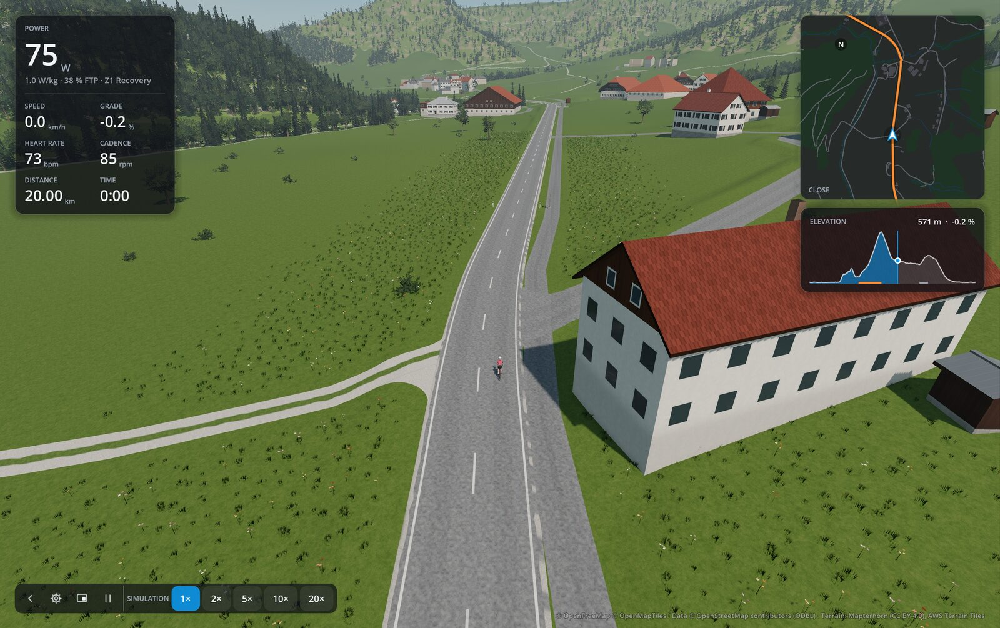
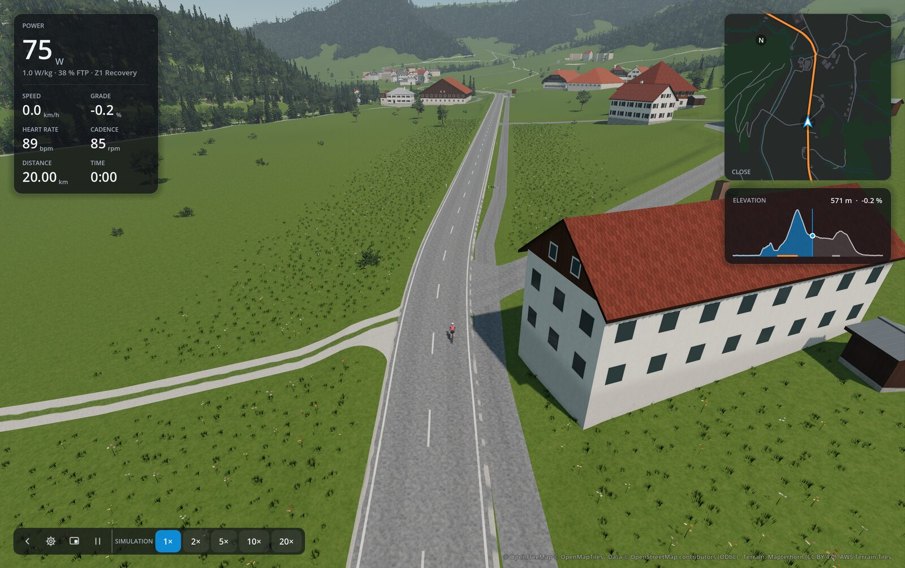
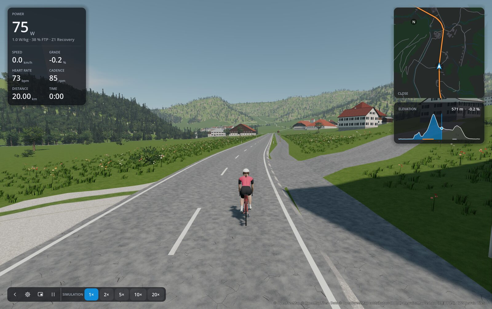
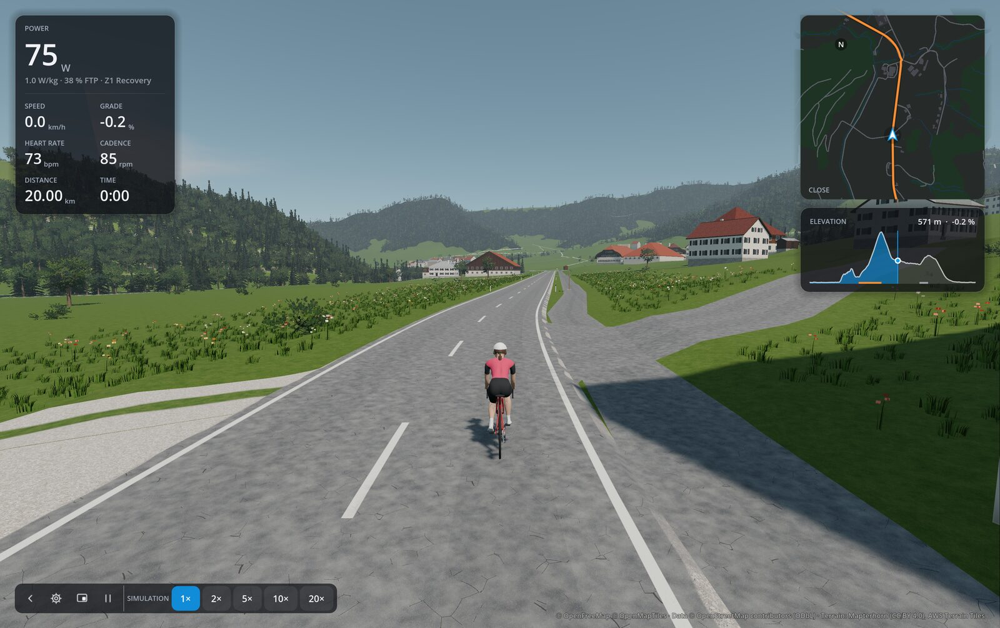
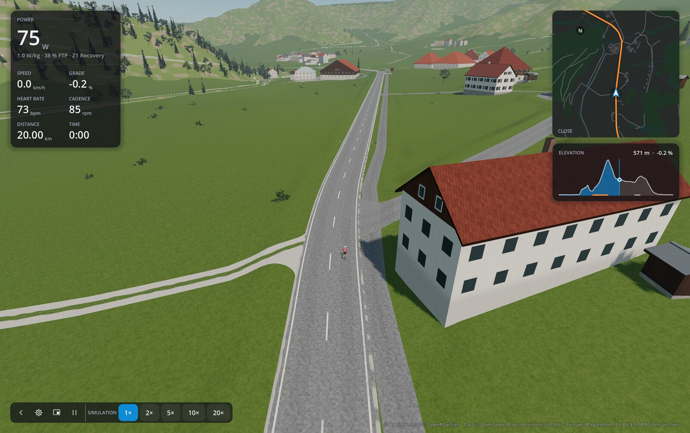
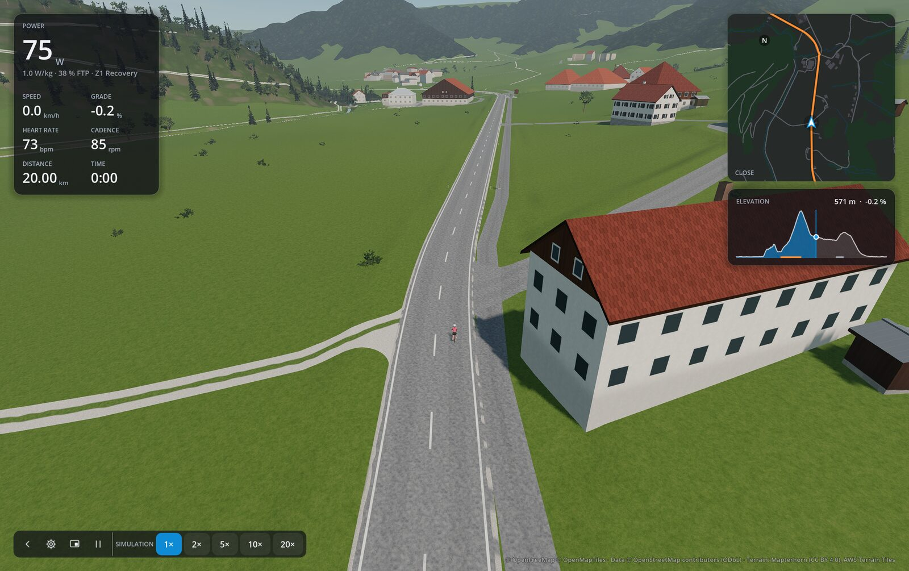

# Distant forest canopy

2026-10-25, Apple M5 Pro / 64 GB, AC power, Metal 4.0, Forward+, Godot 4.7.2.
These measurements check the canopy on one Mac; they do not establish performance on an M1,
Android, Windows or Linux.

## Conditions

- The Zürich course (37.9 km), its world built afresh from the course's saved inputs; the
  rider paused at 20 km (Sihl valley, forested hills ahead), 30 km (above the city, hills
  beyond), 9 km (Kilchberg) and at the lakefront (2.9 km). Midday / Clear, chase and drone
  cameras, the minimap shown.
- Window 1600 × 900, 3240 × 2036 pixels on the Retina display. V-Sync off, frame limit
  unlimited. 5 seconds settling, then 3 seconds of rendered-frame wall times per sample.
- The installed ORQWA 0.5.1 extension with resource packs exported in Docker from `main`
  (before) and this change (after), measured with `scripts/perf/`
  ([Measuring frame rate](../development.md#measuring-frame-rate)).

## Frame times

Median frame time; the canopy itself costs nothing measurable, and tracks ending at 1 km
save a little.

| Place | Camera | Preset | Before | After |
|---|---|---|---:|---:|
| Sihl valley | Drone | Ultra | 32.9 ms | 32.8 ms (32.3 ms on a second visit) |
| Above the city | Drone | Ultra | 33.4 ms | 32.1 ms |
| Lakefront | Drone | Ultra | 24.4 ms | 22.4 ms |
| Sihl valley | Chase | Ultra | 30.0 ms | 29.8 ms |
| Kilchberg | Chase | Ultra | 20.5 ms | 20.0 ms |
| Sihl valley | Drone | Low | 8.7 ms, 8.3 ms | 8.0 ms, 7.5 ms |
| Kilchberg | Drone | Low | 10.0 ms | 7.3 ms |

The first after-run showed a 95th-percentile frame of 166 ms at its first place, once; no other
run did. A Low run measured alone read 9.7 ms; back to back with before, Low was the faster.

## Pictures

| View | Before | After |
|---|---|---|
| Drone above the Sihl valley, Ultra |  |  |
| From the road, Ultra |  |  |
| Drone above the Sihl valley, Low |  |  |

Before, the hills read as scattered trees on pale ground, savanna rather than the woods
mapped there; after, as closed forest with meadows and clearings light between, and nearby
woods unchanged. The first after-run left forest tracks as bright lines across the canopy:
they now end 1 km away, which also takes field tracks and paths out of the far distance.
