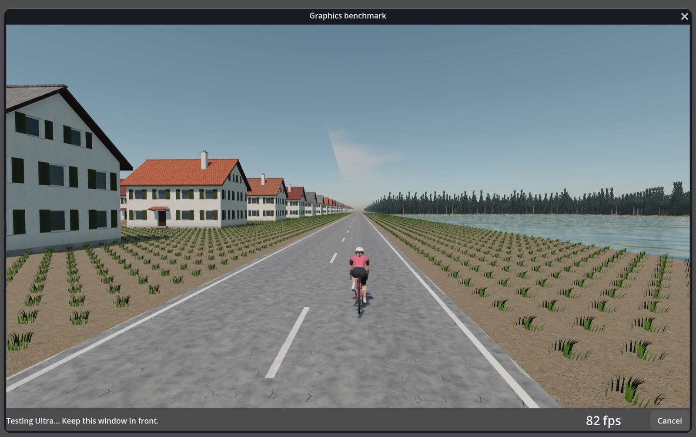

# Native Retina graphics calibration

2026-10-27, Apple M5 Pro (20 GPU cores), Metal 4.0 / Forward+, Godot 4.7.2.

The first calibration recommended Low on this Mac. Its actual window framebuffer was
2722 × 1710 pixels, independently checked by capturing the rendered image. At interface
scale 2, `Window.get_texture().get_size()` reported 5444 × 3420: the benchmark had applied
the UI scale again and drawn four times the pixels a ride would draw. The root viewport
also retained the hidden ride's camera and Ultra post-processing behind the preview.

## Conditions

- The same native executable and GDExtension from PR #386, commit `9ba49c1`, with resource
  packs exported in Docker. Selection policy and scene data are unchanged between runs.
- A graphics-only main loop, with no `OrqwaApp` instance: rider data, computer settings,
  courses, recording, Bluetooth and updates are never opened. The temporary app uses a
  different Godot user directory. No other ORQWA instance or concurrent checks run.
- The ordinary `UiScale` window setup at scale 2, a hidden `RideWorld` at Ultra behind
  Settings, and the same benchmark preview and repeating camera pan as the app. Settings
  is hidden for the preview after reproducing its conflicting-exclusive-window error.
- Three seconds warming each preset, then three seconds of rendered-frame wall times,
  after uploads and ground LOD work finish. The decision uses the same 17.5 ms p95 budget
  for 60 fps throughout. FPS below is the sample mean, not a GPU timestamp counter.

## Results

| Preset | Original FPS | Original p95 ms | Corrected FPS | Corrected p95 ms |
|---|---:|---:|---:|---:|
| Low | 71.2 | 14.41 | 262.2 | 4.09 |
| Medium | 43.1 | 23.70 | 161.0 | 6.69 |
| High | 32.3 | 31.49 | 93.9 | 11.05 |
| Ultra | 29.8 | 34.64 | 81.5 | 13.02 |

The original selected **Low** at 5444 × 3420. The corrected run selected **Ultra** at
2722 × 1710, using physical `Window.size` and temporarily disabling only the main viewport's
3D. An intermediate run that suspended background 3D but retained the wrong pixel size
still selected Low: Medium improved to 51.6 fps / 19.87 ms p95, below target. Correcting the
pixel size is essential; merely relaxing the target would have hidden the error.

[Raw measurements](graphics-calibration.csv) include that intermediate run. This is one
bounded workload on one Mac, not a promise of Ultra at 60 fps on every course or display.
A repeat with the live counter enabled also chose Ultra: 80.4 fps / 13.28 ms p95.

## Recheck

Use Settings → Graphics → Benchmark graphics in a downloaded build containing the fix.
Its live counter shows each preset's rolling FPS; the completed result shows the chosen
preset, measured FPS and tested physical pixel dimensions. The Godot log records mean FPS
and p95 frame time for each preset once it is measured. At a different resolution the
recommended preset may differ.

The rendered smoke test opens Settings before calibration, exercises a non-unit interface
scale, compares the preview target with the actual captured framebuffer, checks live/result
FPS visibility, and verifies restoration of the main viewport's 3D on cancel and completion.
See [development](../development.md#measuring-frame-rate) for its commands.
