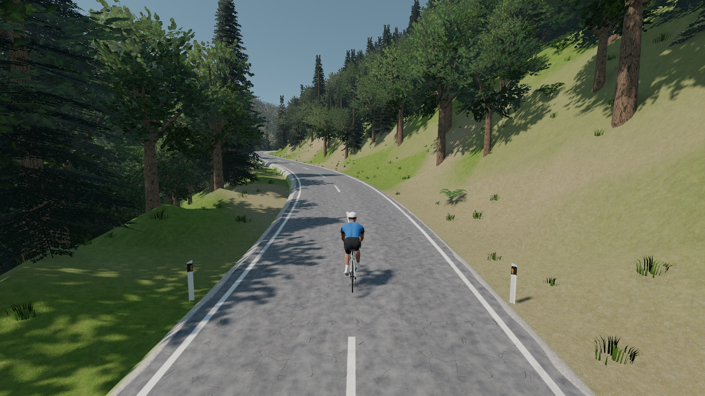
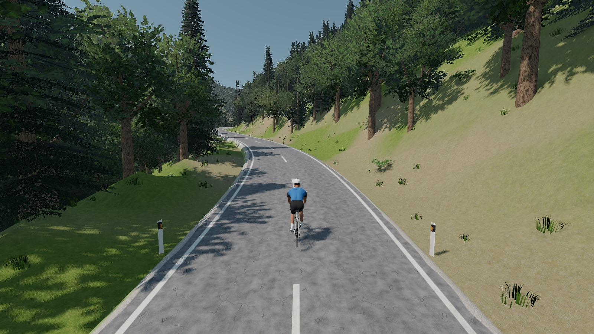
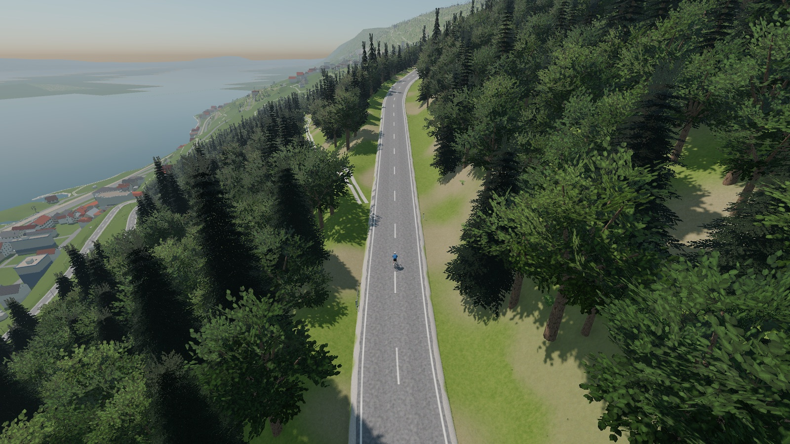

# Native tree LOD measurements

2026-10-21, Apple M5 Pro / 64 GB, AC power, Metal 4.0, Forward+, Godot 4.7.2.
These measurements validate this rendering change on one Mac; they do not establish
performance on an M1, Android, Windows or Linux, or at higher Retina/fullscreen resolutions.

## Conditions

- Same Twann–Chasseral kept world (273 chunks, generator 5), paused at 2,750 m in the
  wooded straight toward Lamboing. Fixed chase camera, Midday / Clear.
- Actual captured viewport 1600 × 900 pixels, render scale and effects from each preset.
  V-Sync off, frame limit unlimited; all chunks uploaded before every sample.
- 15 seconds settling followed by 8 seconds of rendered-frame wall-time samples.
  Screenshots saved after timing. One native ORQWA instance at a time; no concurrent checks.
- Both passes use the supplied native ORQWA 0.5.1 / 7809c90 executable and GDExtension.
  Resource packs were exported in Docker. Baseline graphics source: 979ab77; after:
  this implementation. No native dependencies or Rust builds were needed.
- GPU timestamp counters returned zero on this runtime. FPS and frame time are the
  evidence, not GPU milliseconds or instanced-LOD primitive counters.

## Results

| Configuration | Before FPS | After FPS | Before p95 ms | After p95 ms |
|---|---:|---:|---:|---:|
| Screenshot settings | 32.1 | 67.3 | 32.39 | 15.37 |
| Ultra preset | 18.5 | 41.6 | 55.80 | 24.86 |
| Medium preset | 91.4 | 144.0 | 11.27 | 7.20 |
| Low preset | 247.8 | 275.2 | 4.38 | 4.73 |
| Screenshot repeat | 32.1 | 67.6 | 32.47 | 15.30 |

“Screenshot settings” means Ultra quality and tree density, Medium shadows, view distance
and grass, with the remaining effects Auto. Other rows use their complete presets.
The forest population, graphics choices and camera were unchanged within each comparison.
[Raw figures](tree-lods.csv) include median frame time and draw calls.

Low retains its original chunk-sized batching; its draw-call count stays unchanged.
Medium–Ultra trade more draw calls for much cheaper distant tree and shadow geometry.
Full Ultra remains expensive with its other effects enabled; this is not a promise of 60 FPS
on every scene or device. Additional chase/drone captures at 1,840 m and 2,750 m check coverage.

| Before | After |
|---|---|
|  |  |



## Recheck a downloaded build

Use the same course, camera, position and pixel resolution. Set the preset/details above,
V-Sync Off and frame limit Unlimited, then ride and pause in the same place. Allow loading
and shader setup to settle before comparing the sustained FPS. For live console output on
macOS, run under a pseudo-terminal:

```sh
script -q /tmp/orqwa-fps.log /Applications/ORQWA.app/Contents/MacOS/ORQWA \
  --resolution 1600x900 --windowed --print-fps
```

Do not run two builds at once; use repeated baseline samples to check for drift. Godot's
software Vulkan renderer is useful for appearance checks but does not predict native GPU FPS.

See [the rendering decision](../adr/0020-realistic-look.md#authored-tree-lods-2026-10-21-r43r108)
and [model detail comparisons](../../art/README.md#tree-detail-levels). Godot documents
[projected-size LOD and MultiMesh selection](https://docs.godotengine.org/en/stable/tutorials/3d/mesh_lod.html).
