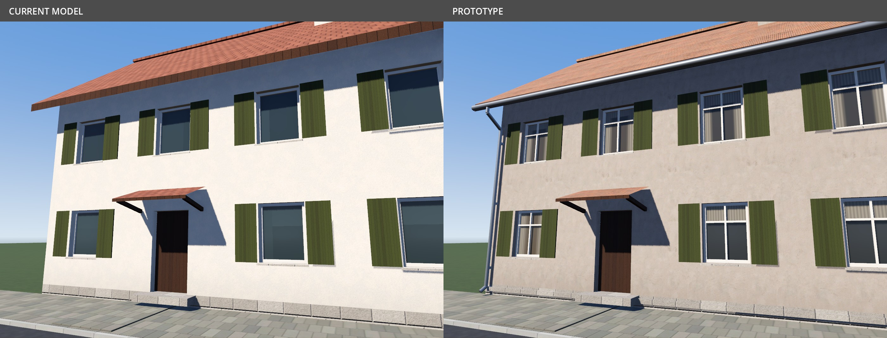
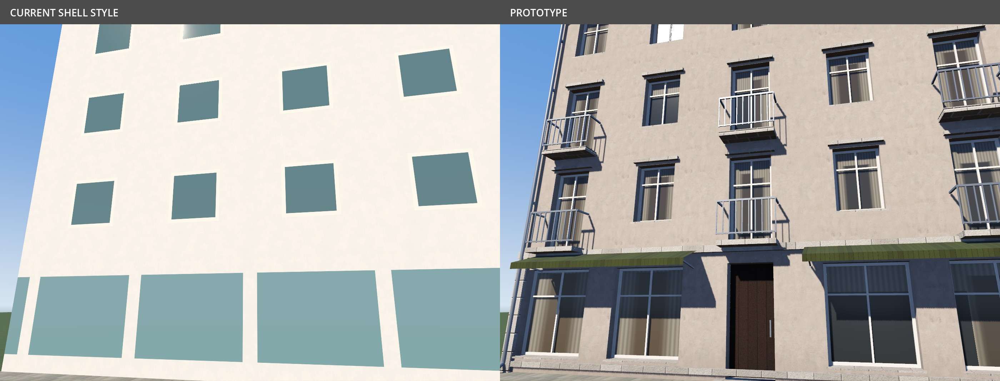

# Building realism study

An unshipped visual prototype for R89: a house and a four-storey town building, rendered in
Godot with the same camera, lighting, ground, palette and exposure before and after. This
study does not change application assets, placement, saved worlds or rider workflows.

The house baseline is the committed `house_gable_2_m.glb`. Its proposed version keeps the
existing mass and recessed openings, adding glazing bars, varied curtains/blinds, gutters,
downpipes and plinth trim. The town baseline is a representative rectangular shell using
the current shell shader's flat window and shopfront patterns; it is not a captured building
from a course. The proposed town building adds recessed openings, shop windows and awnings,
cornices, shallow balconies with open metal railings, and drainage. Its footprint, eaves and
roof pitch match the baseline. The chimney is an added roof detail.

The proposed models use archived CC0 scanned plaster and house roof tiles, with OpenGL
normal and roughness maps. Materials retain the existing shared building shader's behaviour,
with study-only curtain/blind patterns and surface variation. This is an inexpensive visual
suggestion of rooms, not modelled interiors or a complete reflection solution.

| House: current model / proposed detail | Town: representative shell / proposed façade |
|---|---|
|  |  |

[House at street height](images/building-realism/house-street-comparison.jpg) ·
[Town at street height](images/building-realism/town-street-comparison.jpg)

The proposed house has **2,624 triangles**; the town building has **6,188**. These are
single-building counts, not evidence of ride performance. The next step after visual review
is integration with world-generated façades and distance detail, followed by real-course
rendering and measurement against R43's Medium/M1 budget. No frame-rate claim is made from
software rendering.

## Proposed graphics rollout

Start the additional façade geometry and simulated window interiors on **Ultra**. Gutters,
downpipes, glazing bars, open balcony rails, awnings and other small details should use a
short camera range and fall back to the simpler appearance at distance. Low, Medium and High
keep their current geometry initially; the improved shared surface textures can be evaluated
across presets within their existing texture budgets. Medium retains R43's M1 frame-time
target. Measure a dense real street before extending detailed geometry to other presets.

Choose detail in presentation so changing the graphics preset does not itself require
regenerating a kept world. The standalone comparison does not implement this quality gating;
it establishes the visual direction for that integration.

## Reproduce

Run from the application checkout. Both commands use the existing containers and need no
native dependencies or new packages. Originals are archived under
`art/sources/painted-plaster-wall/` and `art/sources/roof-tiles/`, so the study itself needs
no asset downloads.

```sh
scripts/art.sh blender --background --factory-startup \
  --python art/studies/building_realism.py
scripts/dev.sh sh -c '
  godot --headless --path screenshots/building-realism/project --editor --import &&
  OUT_DIR=/workspaces/orqwa/screenshots/building-realism/renders \
  GALLERY=/workspaces/orqwa/docs/images/building-realism \
  timeout 300 xvfb-run -a -s "-screen 0 1400x1000x24" \
  godot --path screenshots/building-realism/project \
    --rendering-method forward_plus --rendering-driver vulkan \
    --audio-driver Dummy --resolution 1400x1000 -s res://render.gd
'
```

`KINDS=house` or `KINDS=town` limits a render. The script writes street and detail views of
both versions; it does not load a course or rider library. Generated GLBs, converted WebP
maps and the standalone Godot project stay in ignored `screenshots/building-realism/`.
`GALLERY` selects where the labelled JPEG comparisons go; without it they stay beside the
scratch renders. `COMPOSE_ONLY=1` rebuilds comparisons from existing renders.
See [credits](CREDITS.md) and each scan's `SOURCE.md` for provenance and checksums.
